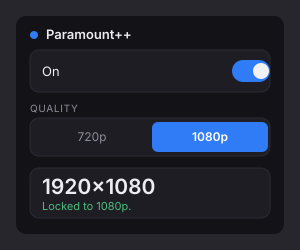

  

<h1 align="center">Paramount++</h1>

  Makes Paramount+ play at 720p or 1080p instead of the soft 540p its web player settles on.

  
  
  
  

---

## Install

**[Download Paramount++](https://github.com/VibecoderJoe555/paramount-plus-plus/releases/latest/download/paramount-plus-plus.xpi)** and drag the file into Firefox, then confirm the prompt.

The build is signed by Mozilla, so it survives restarts and updates like a normal add-on.

Requires Firefox 142 or newer on Windows, macOS, or Linux.

## Features

- **720p or 1080p** — pick your ceiling; the player gets nothing lower to fall back to
- **Live switching** — changes apply without reloading the page, and keep your position
- **Toolbar badge** — `HD` or `SD`, green when at your target, amber when it slips
- **Automatic recovery** — when Paramount refuses the HD key, the title is reloaded from an alternate source and resumed where you left off
- **Keeps your audio** — volume and mute survive every switch
- **Self-healing** — if a switch leaves the player spinning, the page reloads itself once

## Why the player settles on 540p

Paramount ships two video ladders inside one DASH manifest:

| Set | Codec | Heights |
| :-- | :---- | :------ |
| HD | `avc3` | 1080, 720 |
| SD | `avc1` | 540, 432, 360, 234 |

The player only accepts `avc1`, so it discards the HD set and plays the SD ladder. Each set also declares its own content key (`cenc:default_KID`), so the two ladders are not interchangeable at the licence level.

Paramount++ rewrites the manifest so only the representations at your chosen height remain, and drops the sets that end up empty. The media itself is never touched.

Forcing HD usually fails once with **error 2103** — the licence for the HD key is not granted on the ad-inserted stream. The extension recognises that specific failure (it checks the missing key id against the one it forced), asks the site's own player SDK to reload the title from the alternate source, and restores your position.

## What you will notice

- A **brief 2103 flash and a short reload** when playback starts. That is the recovery working.
- If the alternate source also refuses the key, the page reloads once with the extension off, and you get normal playback. Untick **On** for that title.
- The popup reports the real decoded resolution, so you can confirm 1080p rather than trusting how it looks.

## Limits

- **1080p is the ceiling on desktop.** Paramount caps its web player there; 4K needs a supported TV device.
- Live channels and some catalog titles top out lower. The popup shows what you actually got.
- Recovery depends on the site's player SDK. If Paramount changes it, recovery declines quietly and you are back to default quality — playback is never broken.

## Permissions

| Permission | Why |
| :--------- | :-- |
| `storage` | Remembers the on/off switch and quality mode |
| `*://*.paramountplus.com/*` | The only site it can read or modify |

No `tabs`, `cookies`, `webRequest`, `scripting`, or `<all_urls>`. No network requests, no telemetry, no remote code.

## Install from source

For development, or to load an unsigned build:

1. Open `about:debugging#/runtime/this-firefox`
2. **Load Temporary Add-on…**
3. Pick `manifest.json` in this folder

Temporary builds disappear when Firefox closes.

## Project structure

| File | Role |
| :--- | :--- |
| `manifest.json` | MV3 manifest |
| `page.js` | Manifest rewriting, in the page's main world |
| `failover.js` | Missing-key detection, source failover, quality switching |
| `content.js` | Injects the engine, relays status, drives the badge, watchdog |
| `background.js` | Toolbar badge |
| `popup.html` / `popup.js` | Toggle, quality selector, live status |

## How this was built

Vibe-coded end to end with an AI coding agent, guided by console logs and diagnostics captured from a real Paramount+ session. There is no build step and no minification — the files shipped are the source, readable as-is.

## License

MIT — see [LICENSE](LICENSE). Copyright (c) 2026 the Paramount++ contributors.

Not affiliated with, endorsed by, or supported by Paramount. All trademarks belong to their respective owners.
